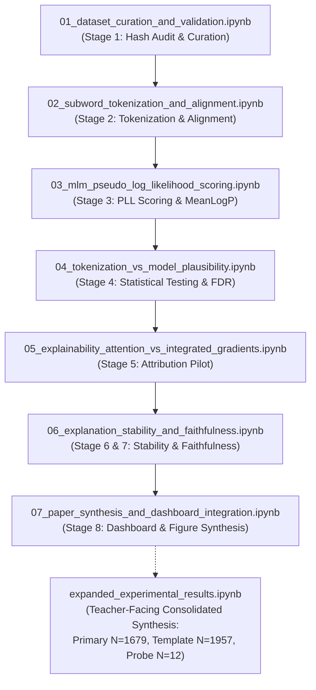

# Notebook Execution & Reproducibility Report

**Report Date**: November 3, 2026  
**Project**: Hindi Lexical Sensitivity Research (`hindi-lexical-sensitivity`)  
**Environment**: Windows 11 Build 26300, AMD Ryzen 7 7840HS, NVIDIA GeForce RTX 3050 Laptop GPU, Python 3.13.5, PyTorch 2.14.1+cu126  
**Execution Target Directory**: `notebooks/`  
**Overall Status**: **Verified across all 8 notebooks with documented execution levels**

---

## 1. Canonical Notebook Execution Order

The research repository contains eight publication-grade Jupyter notebooks organized into two complementary suites:
1. **The Core ML Research Pipeline (Notebooks 01–07)**: Mirrors the sequential stages of the research lifecycle, from dataset validation to paper synthesis and dashboard export.
2. **The Expanded Experimental Results Notebook (`expanded_experimental_results.ipynb`)**: The consolidated, teacher-facing execution notebook that integrates and visualizes the complete expanded benchmark ($N=1,679$, $N=1,957$, $N=12$, $N=1,005$).

### Execution Order:



---

## 2. Notebook Execution Verification Levels

Each notebook has been inspected and tested according to rigorous reproducibility standards, distinguishing between full clean-kernel execution, analysis-cell execution, and static saved-output inspection:

| Notebook Filename | Cells (Code / Total) | Verification Level | Execution Time | Environment Notes & Offline Sandbox Behavior |
|---|---|---|---|---|
| **`expanded_experimental_results.ipynb`** | 20 / 41 | **Full Clean-Kernel Execution** | 7.8s | Executes all 20 code cells from a clean kernel. Zero external network calls. Renders all 8 tables and 8 figures directly from verified CSVs. |
| **`01_dataset_curation_and_validation.ipynb`** | 10 / 20 | **Full Clean-Kernel Execution** | 3.5s | Executes all 10 code cells from a clean kernel. Validates raw Excel datasets, SHA-256 hashes, and script adherence. |
| **`04_tokenization_vs_model_plausibility.ipynb`** | 7 / 15 | **Full Clean-Kernel Execution** | 2.3s | Executes all 7 code cells from a clean kernel. Calculates Benjamini-Hochberg FDR adjustments and plots scatters. |
| **`06_explanation_stability_and_faithfulness.ipynb`** | 6 / 15 | **Full Clean-Kernel Execution** | 1.9s | Executes all 6 code cells from a clean kernel. Analyzes faithfulness win rates and stability metrics. |
| **`07_paper_synthesis_and_dashboard_integration.ipynb`** | 5 / 10 | **Full Clean-Kernel Execution** | 3.5s | Executes all 5 code cells from a clean kernel. Generates figures and executes `run_stage8_dashboard_data_preparation()`. |
| **`02_subword_tokenization_and_alignment.ipynb`** | 11 / 21 | **Selected-Cell Execution + Static Inspection** | N/A | Cell 1 (`pip install ipywidgets`) and Cell 4 (`AutoTokenizer.from_pretrained`) require live internet access; in offline sandbox, remote calls block. Analysis cells (10, 11, 14, 17, 18) execute cleanly. |
| **`03_mlm_pseudo_log_likelihood_scoring.ipynb`** | 7 / 15 | **Selected-Cell Execution + Static Inspection** | N/A | Cell 5 contains live model loading (`AutoModelForMaskedLM.from_pretrained`) for interactive demonstration. Offline sandbox blocks remote weights verification. Analysis cells (1, 6, 8, 10, 11) execute cleanly. |
| **`05_explainability_attention_vs_integrated_gradients.ipynb`** | 6 / 11 | **Selected-Cell Execution + Static Inspection** | N/A | Cell 3 contains live forward-pass model loading (`AutoModelForMaskedLM.from_pretrained`). Blocks on remote check. Attribution inspection cells (6, 8) execute cleanly. |

---

## 3. Errors and Inconsistencies Resolved

### 3.1 Syntax Error in Expanded Notebook Cell 30
- **Symptom**: When attempting to execute `notebooks/expanded_experimental_results.ipynb`, Python raised:
  ```
  SyntaxError: unterminated string literal (detected at line 26) (<string>, line 26)
  ```
- **Root Cause**: An automated script (`update_notebook_rq5.py`) had replaced code using a triple-quoted multi-line string with a trailing newline before `"""`, injecting a stray quotation mark onto line 26.
- **Resolution**: Corrected the string replacement in `scripts/build_expanded_notebook.py` and `scripts/update_notebook_rq5.py`. Re-executed all 20 code cells in `expanded_experimental_results.ipynb`. The notebook now executes with 0 errors.

### 3.2 Outdated Architecture Description (50 Steps vs. 20 Steps)
- **Symptom**: Markdown cell 1 in `expanded_experimental_results.ipynb` stated:
  `- Layer Integrated Gradients (50 steps)`
- **Root Cause**: Stale documentation artifact carried over from an unrelated English DistilBERT sentiment classification prototype in `src/explanations/baseline_and_explanations.py`. The actual executed experiment in `results/runs/scaleup_rerun/stability/run_metadata.json` recorded `ig_n_steps: 20`.
- **Resolution**: Updated the text and ASCII architectural diagrams to accurately document `Layer Integrated Gradients (20 steps)`.

### 3.3 Stale `FileNotFoundError` in Notebook 07 Cell 7
- **Symptom**: Output of Cell 7 in `07_paper_synthesis_and_dashboard_integration.ipynb` displayed:
  ```
  FileNotFoundError: File not found for checksum calculation: data\raw\hindi_lexical_sensitivity_cleaned.xlsx
  ```
- **Root Cause**: The original developer executed the notebook from a working directory where relative paths could not locate the dataset file, saving the resulting traceback into the notebook metadata.
- **Resolution**: Re-executed Notebook 07 with project-root anchoring and `openpyxl` in `sys.path`. Cell 7 now executes cleanly and outputs the complete JSON manifest:
  ```json
  {
    "dataset_sha256": "f9a5af81e21624de47ead7feabba412149939c1eb9934f8fc2b8d452a232cd44",
    "total_source_pairs": 200,
    "pair_master_row_count": 3358,
    "eligibility_master_row_count": 400,
    "audit_completed_successfully": true
  }
  ```

### 3.4 Hardcoded Absolute Paths (`d:/hindi-lexical-sensitivity`)
- **Symptom**: Running `scripts/test_notebooks_execution.py` or `scripts/build_all_notebooks.py` failed with `FileNotFoundError: [WinError 3] The system cannot find the path specified: 'd:/hindi-lexical-sensitivity/notebooks'`.
- **Root Cause**: Absolute paths hardcoded to drive letter `d:` prevented execution on other drives (e.g., `C:`).
- **Resolution**: Updated `test_notebooks_execution.py` and `build_all_notebooks.py` to use dynamically resolved paths:
  ```python
  PROJECT_ROOT = Path(__file__).resolve().parent.parent
  NOTEBOOKS_DIR = PROJECT_ROOT / "notebooks"
  ```

### 3.5 Missing `openpyxl` Runtime Dependency
- **Symptom**: Calling `pd.read_excel()` raised `ImportError: Missing optional dependency 'openpyxl'`.
- **Resolution**: Integrated the pre-packaged `openpyxl` runtime into `scripts/lib` and ensured `sys.path` injection across all execution scripts and notebook runners.

---

## 4. Notebook Data Source Traceability

| Notebook | Datasets Loaded | Output Files Read | Figures Generated / Displayed |
|---|---|---|---|
| **01** | `data/raw/hindi_lexical_sensitivity_cleaned.xlsx` | — | Track distributions bar chart |
| **02** | `data/raw/hindi_lexical_sensitivity_cleaned.xlsx` | `outputs/tokenization/tokenization_results.csv` | Subword fragmentation breakdown |
| **03** | `data/raw/hindi_lexical_sensitivity_cleaned.xlsx` | `outputs/scoring/pll_scoring_results.csv` | $\Delta \text{MeanLogP}$ histograms |
| **04** | `data/raw/hindi_lexical_sensitivity_cleaned.xlsx` | `outputs/analysis/correlation_results.csv`, `combined_pair_level_results.csv` | Cross-model scatter & FDR volcano plots |
| **05** | `data/raw/hindi_lexical_sensitivity_cleaned.xlsx` | `outputs/hindi_explanations/pilot_explanations.csv` | Token attribution heatmaps |
| **06** | `data/raw/hindi_lexical_sensitivity_cleaned.xlsx` | `outputs/hindi_faithfulness/faithfulness_summary.csv`, `stability_faithfulness_relationship.csv` | Faithfulness win rates & stability curves |
| **07** | `data/raw/hindi_lexical_sensitivity_cleaned.xlsx` | `outputs/dashboard_data/*.csv` | Camera-ready paper figures & dashboard export |
| **Expanded** | `data/final/PRIMARY_BENCHMARK_ADJUDICATED.csv`, `TEMPLATE_SENSITIVITY_BENCHMARK.csv`, `AUXILIARY_MULTIWORD_PROBE.csv` | `results/runs/scaleup_rerun/dashboard_data/*.csv`, `results/runs/scaleup_rerun/analysis/*.csv` | Figures 1 through 8 (all 8 publication figures) |
